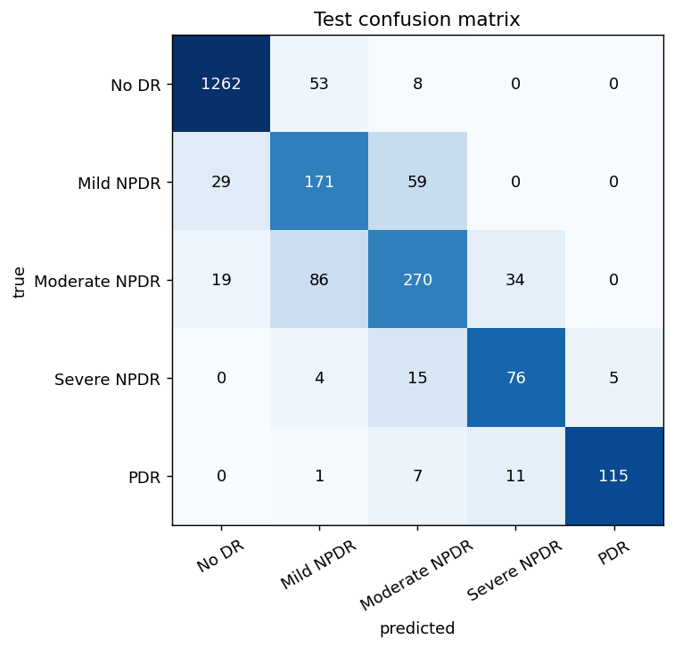
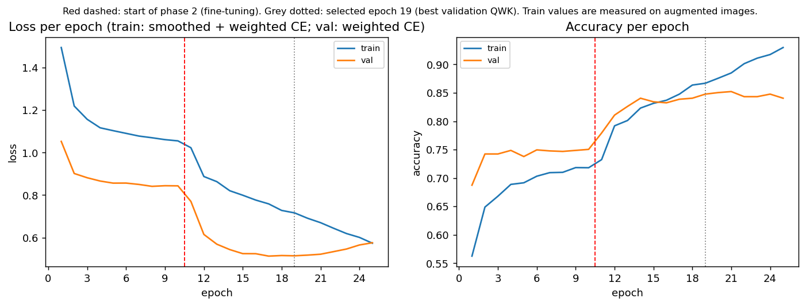
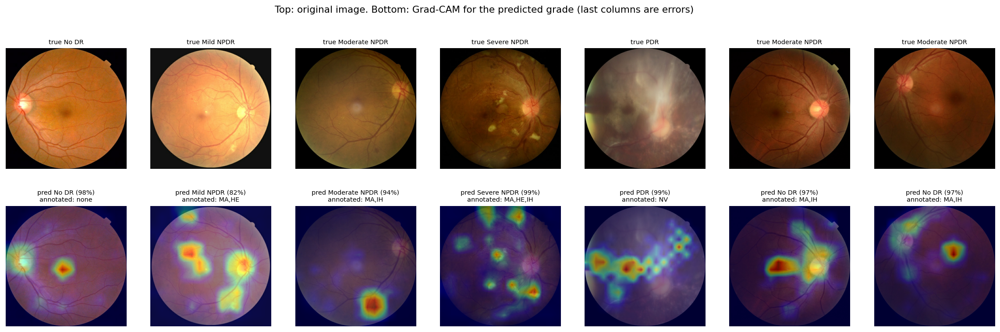
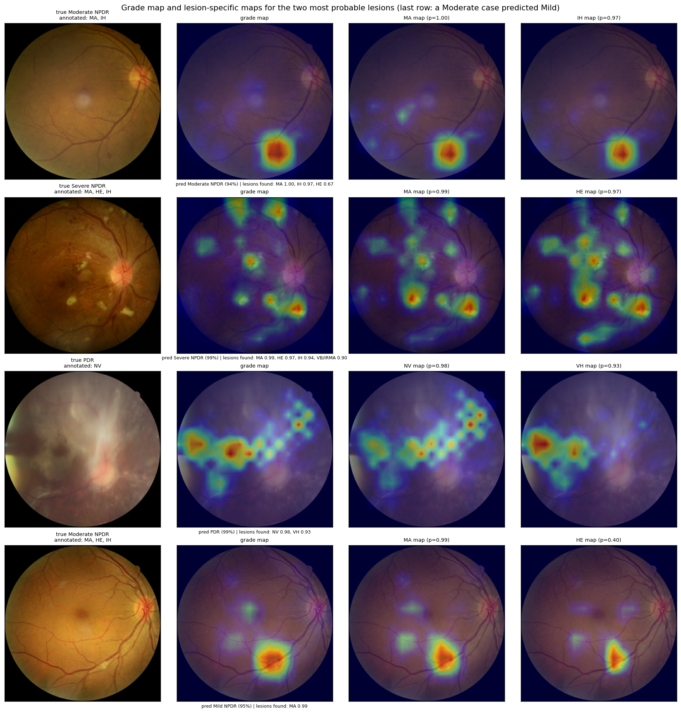

# LG-EffNetV2-S for Diabetic Retinopathy Grading

**LG-EffNetV2-S (Lesion-Guided EfficientNetV2-S)** grades diabetic retinopathy (DR) from colour fundus photographs
(CFP) of the MMRDR dataset into five grades, and explains each prediction with calibrated confidence, referral of
uncertain cases and lesion-level evidence. It is an ImageNet-pretrained EfficientNetV2-S with a **grade head** and an
auxiliary **lesion head**: supervising the shared features with the 7 MMRDR lesion labels guides the network towards
the findings that define each grade, and lets the model report *which* lesions it sees and *where* (Grad-CAM).

## 1. Results

| Model | Notebook | Accuracy | Macro-F1 | QWK |
|---|---|---|---|---|
| **LG-EffNetV2-S** | `LG-EffNetV2-S_model/02_LG-EffNetV2-S.ipynb` | **0.851** | **0.770** | **0.930** |

## 2. Resources

| Resource | Link |
|---|---|
| Original MMRDR dataset | <https://figshare.com/articles/dataset/MMRDR/29423747> |
| Preprocessed CFP dataset (512×512) | <https://www.kaggle.com/datasets/mariajabeen01/mmrdr-cfp512> |
| Trained LG-EffNetV2-S weights | <https://www.kaggle.com/datasets/mariajabeen01/effnetv2s-v3-dr-weights> |

## 3. Preprocessed dataset

### Option A — use the published preprocessed dataset (recommended)

* **Kaggle:** add <https://www.kaggle.com/datasets/mariajabeen01/mmrdr-cfp512> as an input.
* **Local machine:** download it with the Kaggle CLI, or from the dataset page.

### Option B — reproduce the preprocessed dataset from the original MMRDR release

1. Run from the repository root:

   ```bash
   python scripts/prepare_data.py --out data --size 512
   # optional: --keep-original (also save the original JPEGs), --workers 8, --limit 50 (quick test)
   ```

2. Result (11,118 labelled images):

   ```
   data/
   ├── MMRDR-CFP/FP.csv          # original labels
   └── cfp512/
       ├── FP.csv                # labels used by the notebooks
       ├── prep_meta.csv         # original size and crop box per image
       └── img/*.jpg             # preprocessed images
   ```

## 4. Run on Kaggle

The notebooks were developed and run on Kaggle (Python 3.13, TensorFlow 2.20, Keras 3.13, GPU T4).

### 4.1 Common setup

1. Sign in to Kaggle.
2. **Code → New Notebook → File → Import Notebook**, and upload `LG-EffNetV2-S_model/02_LG-EffNetV2-S.ipynb`.
3. **Add Input**:
   * `mariajabeen01/mmrdr-cfp512` (preprocessed images) — always;
   * `mariajabeen01/effnetv2s-v3-dr-weights` (trained weights) — only to use the trained LG-EffNetV2-S.
4. **Settings → Accelerator → GPU T4 x2** (or *GPU T4*; the notebook uses one GPU).

### 4.2 The `train` flag

`train=False` is the default: the notebook loads `effnetv2s_v3_tf_dr.weights.h5` and `history.csv` and runs the whole
evaluation and explainability pipeline. With `train=True` it trains both phases, saves the best weights and then runs
the same pipeline.

## 5. Run on a local machine

### 5.1 Requirements

* Python 3.10–3.13 (tested: 3.13.15).
* **Evaluation with the trained weights:** CPU is enough (slower, roughly 30–60 min), ~8 GB RAM.
* **Training:** an NVIDIA GPU with ≥ 12 GB memory and CUDA support (Linux or WSL2) is strongly recommended.

### 5.2 Install

```bash
git clone https://github.com/<your-username>/LG-EffNetV2-S-DR-Grading.git
cd LG-EffNetV2-S-DR-Grading
python -m venv .venv
source .venv/bin/activate            # Windows: .venv\Scripts\activate
pip install -r requirements.txt
# NVIDIA GPU on Linux/WSL2 only: also install the CUDA libraries
pip install "tensorflow[and-cuda]==2.20.0"
python -c "import tensorflow as tf; print(tf.__version__, tf.config.list_physical_devices('GPU'))"
```

### 5.3 Run

Environment variables (set them before starting Jupyter or the script):

| Variable | Meaning | Default |
|---|---|---|
| `DRXAI_TRAIN` | `0` = use the trained weights · `1` = train LG-EffNetV2-S from ImageNet weights | `0` |
| `DRXAI_DATA` | folder with `FP.csv` and `img/` | `data/cfp512` |
| `DRXAI_WEIGHTS` | folder with the trained weights | `weights/` |
| `DRXAI_OUT` | output folder | `outputs_<model>/` in the repository root |

**Headless (recommended):**

```bash
# LG-EffNetV2-S with the trained weights: evaluation + explanations
bash scripts/run_notebook.sh LG-EffNetV2-S_model/02_LG-EffNetV2-S.ipynb

# LG-EffNetV2-S trained from scratch, then evaluation + explanations
DRXAI_TRAIN=1 bash scripts/run_notebook.sh LG-EffNetV2-S_model/02_LG-EffNetV2-S.ipynb
```

## 6. Experimental protocol and reproducibility

* **Test set:** official MMRDR `ts*` split (2,225 images).
* **Validation:** 12.5 % of the official training split (7:1, as in the MMRDR benchmark).
* **Training:** ImageNet EfficientNetV2-S (`keras.applications`).
  * Phase 1: frozen backbone, AdamW lr 1e-3, up to 10 epochs.
  * Phase 2: from the best phase-1 weights, backbone fine-tuned (BatchNorm frozen), lr 1e-4 cosine to 0, up to 25 epochs.
  * Patience 6, batch 16, weight decay 1e-4, sqrt inverse-frequency class weights, mixed precision on GPU.
* **Hyperparameters:** `configs/LG-EffNetV2-S_config.json`.
* **Seeds:** `seed=42` for Python, NumPy and TensorFlow.
* **Split:** `results/LG-EffNetV2-S/split.csv` lists the train/val/test assignment of every image.

## 7. Example outputs

All figures and tables of the reported LG-EffNetV2-S run are in `results/LG-EffNetV2-S/`.

| Confusion matrix | Training curves |
|---|---|
|  |  |
| **Grad-CAM** | **Lesion-specific Grad-CAM** |
|  |  |

* **Grading:** `test_metrics.csv`, `classification_report.txt`. **Lesions:** `lesion_detection.csv` (AUROC 0.95–0.998).
* **Reliability:** temperature T = 0.80 (ECE 0.038 → 0.032). Referring the 20 % least-confident cases catches 58.9 %
  of errors (64.7 % combined with the grade–lesion consistency check). Blur lowers QWK from 0.930 to 0.871.
* **Referable DR (grade ≥ 2):** sensitivity 0.829, specificity 0.958. 19 / 134 PDR images are under-graded; the
  lesion-consistency check flags 17 of them.

## 8. Acknowledgements and external resources

* **Dataset:** MMRDR (Tang *et al.*, 2026), CC BY 4.0, <https://figshare.com/articles/dataset/MMRDR/29423747>.
  Example fundus images in the figures come from this dataset.
* **Pretrained model:** EfficientNetV2-S (Tan & Le, ICML 2021), ImageNet-1k weights from `keras.applications`.
* **Methods:** Grad-CAM (Selvaraju *et al.*, ICCV 2017); temperature scaling (Guo *et al.*, ICML 2017).
* **Libraries:** TensorFlow/Keras, scikit-learn, SciPy, NumPy, pandas, Matplotlib, Pillow.
* All other code in this repository was written by the author.

## Licence

Code: MIT (see `LICENSE`). The MMRDR data and anything derived from it (including the preprocessed dataset and the
example images) remain under the dataset's licence, CC BY 4.0.